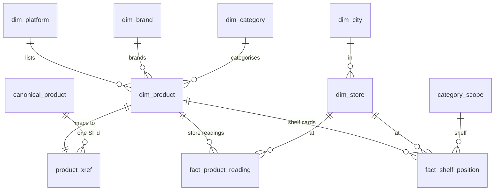

# SIDNL architecture

Facts verified against the live database on 2026-11-10. The exact definition of every object is in `sql/01..03`
(generated from the database); this document explains how they fit together.

## 1. Layers and keys
- **Bronze** = every schema except `silver` and `dash` (today the `public` scraper tables; `ecomscraper` is empty).
  Never written by this system. Sources read: `shelf_snapshots` + `shelf_positions` (category shelves, all brands),
  `search_snapshots` + `search_cards` (brand searches), `observations` (product-page stock checks), `platform_listings`,
  `platform_products`, `products`, `stores`, `cities`.
- **Silver** = cleaned facts. One silver row = one bronze row; values are copied, never changed.
- **Dash** = front-end tables rebuilt from silver on every gold refresh.
- **Ops** = run history, quality results, alerts, reconciliation, dead letters.
- **Keys.** Facts carry the stable `product_key` (= one platform listing). `silver.product_xref` maps each
  `product_key` to its `sidnl_id`. SI ids are kept **A-Z by product name** and renumbered by
  `silver.resequence_sidnl()` at the end of every run (36 of 54 runs on 2026-11-10 renumbered, up to 7,108 ids), so
  they are **never** copied into silver fact tables. Dash tables are keyed by `sidnl_id` and are rebuilt in full
  (`sidnl_config.gold_visibility_days = NULL`) so a renumbering can never leave stale ids on the dashboard.



## 2. Silver tables
| Table | Grain | Used for |
|---|---|---|
| `dim_platform`, `dim_city`, `dim_store`, `dim_brand`, `dim_category` | dimensions | everything |
| `dim_product` | platform × platform_product_id; pack parsed to `size_value` / `size_unit` / `pack_count`, `total_content` generated | everything |
| `canonical_product` | one row per real product (SI id); attributes follow the anchor member | SI lookups |
| `product_xref` | product → SI id, match method, score | SI lookups |
| `match_review_queue` | fuzzy suggestions waiting for a human | review |
| `fact_product_reading` | one product at one store at one time (price, MRP, stock, inventory, search rank) | OSA, price, inventory |
| `fact_shelf_position` | one product card on a category shelf | share of shelf, rank |
| `fact_store_scan` | one brand-search scan of a store | listing % denominator |
| config | `sidnl_config`, `brand_scope` (client brands), `category_scope` (shelves + watermarks), `pipeline_source` (bronze watermarks), `freshness_policy`, `ref_noise_word`, `ref_variant_synonym`, `brand_string_registry`, `ref_metric_support` | automation |

Views used by consumers: `v_sidnl_product`, `v_reading_by_sidnl`, `v_shelf_by_sidnl`, `v_canonical_product_map`,
`v_canonical_brand_summary`, `v_sku_listing`, `v_match_health`; **Rag reads** `v_latest_observation`,
`v_latest_shelf_position`, `v_all_platforms`, `blinkit`, `zepto`, `instamart`, `jiomart` (do not rename or drop).

Data quality: every fact row has `dq_status` (valid / suspect / invalid); metrics use `valid` only. Results per run in
`ops.dq_result`.

## 3. The silver run (`silver.run_pipeline`, called by `silver.run_tick`)
1. Advisory lock 727100; a second run returns `skipped`. Runs at most every `pipeline_min_interval_seconds` (120) unless forced.
2. Nothing new in the six watched bronze tables (`max(id)` vs `pipeline_source`) and nothing unmapped → `idle`, writes nothing.
3. Discover platforms / categories / brands → `refresh_brand` per client brand (isolated) → `refresh_category_market`
   per category scope (isolated, own watermark) → `map_new_products` → `sync_canonical_attrs` → `resequence_sidnl` →
   quality gate (`dq_run_gate`).
4. Status `success` / `partial` (a step failed) / `blocked` (gate). Only `success` queues a gold refresh.
5. Watermarks advance only for what loaded and passed the gate; everything else is re-read next run (idempotent upserts).
6. Retries (`ops.pipeline_job`): 5 attempts, waits 2/4/8/16 min, SQLSTATE classes 22 23 42 0A 2B 44 0L 28 and gate
   blocks are permanent (not retried).
7. New platforms and category shelves register themselves (`register_platforms`, `register_category_scopes` once a
   shelf was read at `category_min_stores` = 10 stores). A new client brand: insert into `silver.brand_scope`.

Quality gate: shelf row without product/store/brand, bronze rows missing from silver, canonical self-tests and SI-id
integrity **block** the scope; negative price is **rejected** (row invalid; scope blocked above `dq_reject_block_pct` 5 %);
price > MRP is a **warning**; missing city / coordinates / category is **accepted**.

## 4. Canonical products (SI ids)
Decision order for a new product:
1. Same client catalog product on two platforms → same SI id.
2. **Exact**: same brand + same normalised name + same normalised pack (`silver.exact_key`) → same SI id, also a second
   listing on the same platform (`EXACT_NAME_PACK`).
3. **Exact across platforms** (`sidnl-auto-match`, `silver_058`): same brand, same name (lower-case, trimmed, single
   spaces), same parsed size / unit / pack count, different platform → merged automatically.
4. Fuzzy score ≥ 0.75 (name 35 %, brand 25 %, size 20 %, variant 15 %, category 5 %; strict rules: pack count differs,
   size differs > 5 %, brand conflict, opposing variant) → own SI id + a `match_review_queue` row for a human.
   `auto_merge_fuzzy` = 0 on purpose: high fuzzy scores were wrong in real data (e.g. "Gud Shrikhand Badam Pista" vs
   "Gud Shrikhand", Lemon vs Lime).
5. Below 0.75 → new SI id.

Pack parsing (`silver.parse_pack`, `silver_056`): size = content of one pack (g, ml or pieces), pack_count = number of
packs, total = size × count. `100 g X 2` = 100 g × 2; `10 pcs` = 10 pc × 1; `40U x 25g` = 25 g × 40; `7 pcs + 102 g` =
102 g (a mixed list is never multiplied). The exact bronze strings are asserted in `silver.selftest_parser()`.

Review: `silver.approve_match(id)`, `silver.reject_match(id)`, `silver.merge_canonical(from, to)` (refuses same-platform
merges), `silver.unmap_product(product_key)`. Lookups: `silver.sidnl_everything('SI001')`, `silver.sidnl_find('<words>')`.

Store city (`silver_060`): when `public.stores` has no city, the store gets the single city recorded on all of its
bronze scrape snapshots (`ops.store_city_filled`); stores whose snapshots name two cities stay without a city.

## 5. Dash (front end)
`silver.run_gold_pending()` (lock 727101) takes the newest successful silver run, runs `dash.sync_dims()` and
`dash.refresh(NULL)` in one savepoint, and records each table in `dash.refresh_table_state`.

| Table | Grain | Feeds |
|---|---|---|
| `availability` | date × platform × city × SKU × store (`store_key` NULL = city total) | OSA %, listing %, stock-outs, inventory, DOI, dark-store map |
| `pricing` | date × platform × city × SKU | SP, MRP, discount, price/100 g, parity vs reference platform (blinkit), changes |
| `visibility` | date × platform × city × search type × term × SKU | impressions, share of voice, top-of-search, ranks |
| `ads` | date × platform × campaign × keyword / placement (`report_level` keyword, placement, campaign) | ad spend, impressions, effective + bid CPM, direct/indirect/attributed sales, ROAS, ATC, units, new users, daily budget utilisation, keyword search volume (section 5a) |
| `ads_campaign_period` | report period × platform × campaign | MTD total budget, claimables, utilisation, proof that claimables = daily spend |
| `ads_keyword_sov` | report period × platform × keyword | searches, sponsored SoV %, own keyword-ad spend / sales / ROAS in the period |
| `overview`, `supply` | defined, **empty**: need sales and ERP/EDI feeds that do not exist yet | — |
| `dim_*` | copies of silver dimensions for the app | names |

Rules: product = `sidnl_id`; each metric stored once; **every % has its numerator and denominator** (roll up as
SUM(num)/SUM(den), never AVG(%)); never add store rows and city rows together.
Views: `v_refresh_status` (last refreshed; `is_stale` = dash is behind silver, i.e. a successful silver run has waited for gold longer than `gold_stale_minutes`; failing; needs attention), `v_data_freshness`, `v_platform_freshness`,
`v_brand_scorecard` + `v_brand_scorecard_latest` (per date × platform × city/ALL × brand: share of shelf and rank,
OSA %, listing %, stock-outs, average discount, parity breaks; NULL = not measured), `v_valid_reading`.
Coverage today: category shelves exist for Blinkit only; availability and pricing for client brands only; OSA (stock
checks) for Mr Munchies only.

Why dash has ~100k rows from ~7k products: one row per product **per day, city and store where it was seen**
(e.g. availability store rows = 945 stores × 7 days × ~10.5 client SKUs per store-day).

## 5a. First-party ads feed: dash built from the formula sheet (`silver_074`, `dash_012`)
```
public.fp_blinkit_ads (bronze: Blinkit ad-console exports; public.fp_load_file = one row per uploaded file, sha256)
   │  silver.load_fp_ads()   upsert every bronze row, delete vanished ones, map placements, MTD period from file name, dq
   ▼
silver.fact_fp_ads  ──►  v_fp_ads_daily (one row per day key: two files with the same day count once)
                         v_fp_ads_keyword_daily, v_fp_ads_campaign_period, v_fp_ads_keyword_period
   │  dash.refresh_ads() -> dash.refresh_formula_table(t) for ads, ads_campaign_period, ads_keyword_sov
   │     rows    = silver.ref_dash_grain     (grain, source view, key columns)
   │     columns = silver.ref_metric_support (dash_table, dash_column, sql_expr, grain_levels) = the formula sheet
   ▼
dash.ads / dash.ads_campaign_period / dash.ads_keyword_sov
```
- **One formula-sheet row per dash column.** Changing a formula = `update silver.ref_metric_support set sql_expr = ...`;
  the next refresh uses it. A new metric = a new row (+ the dash column). `sql_expr` is an aggregate over the grain's
  view (alias `f`); ratios are ratios of sums (`sum(direct_sales)/sum(spend)`), so keyword, placement and campaign
  rows all roll up correctly. `sql_expr` NULL = the exports do not have it (clicks, CTR, CPC, AOV, conversion, reach,
  keyword rank, campaign status, SI id): the column stays NULL, never 0.
- **Runs on its own.** A statement trigger on `public.fp_blinkit_ads` reloads silver and dash right after an upload;
  cron `sidnl-fp-ads` re-runs both every 10 min (formula edits). A failed refresh keeps the previous dash rows and shows
  in `dash.v_refresh_status`.
- **Proof.** `select * from silver.check_fp_ads();` — bronze = silver, duplicate files agree, dash = silver at every
  grain, ROAS = the platform's RoAS, MTD claimables = sum of daily spend, every dash column is in the formula sheet.
  On 2026-11-11 all 9 checks pass, and all 145 daily rows equal the Excel exports value for value.
- **Not possible from these files:** joining ads to SI ids (no product in the exports), clicks-based metrics.
- Front end / API: read `dash.ads` filtered on one `report_level` (never add levels together), plus the two period
  tables. Example: `select obs_date, sum(ad_spend), sum(attributed_sales), round(sum(attributed_sales)/nullif(sum(ad_spend),0),2)
  from dash.ads where report_level = 'campaign' group by 1 order by 1;`

## 6. Proof that dash = bronze (`silver_061`, `silver_063`)
`silver.reconcile()` (daily) compares every reading and every shelf fact with its bronze row (price, MRP, inventory,
rank, ad flag, product, store, platform, time, city), and recomputes `dash.pricing`, availability OSA counts and
`dash.visibility` from silver with independent SQL; plus brand-scorecard totals. `silver.reconcile_coverage()` (daily)
checks every bronze shelf row up to its scope watermark is in silver or dead-lettered. Results: `ops.reconciliation_log`,
latest per check in `ops.v_reconciliation_latest`. Any mismatch writes an alert row. First run: 0 mismatches over
56,249 readings and 1,832,098 shelf rows.

## 7. Fallbacks
| Gap | Status | Mechanism |
|---|---|---|
| 1 Gold failure | **live** (`dash_006`, `dash_007`) | failed refresh = gold `failed`, backoff via `classify_error` / `backoff_minutes`, max `gold_max_attempts` (5); statement timeout caught; previous dash rows kept (savepoint) |
| 2 Stale scraper | **live** (`silver_062`) | bronze freshness per platform × source via id cursor; thresholds `silver.freshness_policy` (stock 48 h, search 24 h, shelf 72 h) + `ops.freshness_override`; status fresh / stale / never_seen / not_expected; events `ops.freshness_event`; alert on stale |
| 3 Bad rows | **live** (`silver_063`, category shelves) | chunk fails with a permanent error → bisect to the failing bronze rows → `ops.dead_letter`; rest loads; retry 15 min with backoff; > 100 rows/chunk or transient error → scope fails as before. Client-brand loader keeps per-brand isolation |
| 4 Alert delivery | **live, switched off** (`silver_065` outbox + `silver_066` sender) | triggers copy `ops.cron_alert_log` / `ops.storage_alert_log` rows into `ops.alert_outbox` (deduped `<table>:<alert_id>`); cron `sidnl-alerts` runs `silver.deliver_alerts()` every minute: posts due rows to the Slack webhook (URL only in Vault secret `slack_webhook_url`) with pg_net, settles from pg_net's response table (2xx = sent; other answer or timeout = retry 2/4/8/16 min, `dead` after 6; a row stuck without any response is marked failed, never resent); off while `alert_delivery_enabled = 0` or the secret is missing; `silver.send_test_alert()` verifies it |
| 5 Cron never starts | **live, locked until the owner creates the token** (`silver_064`, `silver_067`, `silver_068`) | `ops.v_heartbeat` (one row per `sidnl-*` job: schedule, last start/status, expected_by); `public.sidnl_heartbeat(p_token)` (served by the REST API, status set by the function: 200 ok / 503 overdue, paused, failed or never-run job or alert waiting > 30 min / 401 bad token; token = Vault secret `heartbeat_token`) is polled every 5 min by an external uptime monitor; the daily cron job uses `silver.enqueue_daily_safe` (5 s lock timeout) |

Alert rows today (all in `ops.cron_alert_log`): cron failures (3 in a row), `freshness:<platform>/<source>`,
`sidnl-reconcile:data`, `sidnl-reconcile:coverage`, `dead-letter:<scope>`; storage levels in `ops.storage_alert_log`.

## 7a. Applied 2026-11-11 (`sql/migrations/`)
`silver_069` bronze column contract (new reading / scan columns, `pages_read`, `dim_city.center_*` and the stray
`dim_store` weight column removed; a failed or incomplete read never yields out_of_stock). `silver_070` new silver
tables `fact_shelf_snapshot`, `fact_scrape_run`, `fact_serviceability`, `dim_sample_point`, `dim_listing`,
`dim_catalog_product` (loader `silver.refresh_scrape_context()`, isolated sections). `dash_011` `dash.coverage`,
`dash.collection_health`, cron `sidnl-context` (every 10 min). `silver_071` one self-test suite `silver.selftest()`.
`silver_072` quality gate reads the processing window (knob `dq_gate_window`). Details, bottlenecks and roadmap:
[PIPELINE_STATUS_2026-11-11.md](PIPELINE_STATUS_2026-11-11.md). `sql/01..03` still need `python sidnl.py export-schema` to include these objects.

## 8. Known limits
- Gold rebuilds dash in full (~40 s today). At much larger volume it needs an incremental refresh keyed by a stable id.
- 10,787 bronze stock checks of non-client brands are outside `silver.brand_scope` and not loaded.
- Instamart and JioMart have no bronze rows; Zepto observations stopped on 2026-10-30 (see `dash.v_platform_freshness`).
- ~40 fuzzy match reviews wait for a human.
- `Rag/` queries `silver.demo`, which was dropped in `silver_054`.

## 9. History (applied migrations; exact SQL in `supabase_migrations.schema_migrations`, list in `sql/manifest.csv`)
- `silver_000`–`035` (2026-11-06/07): schema, parser, dimensions, facts, matcher, SI ids, pipeline and cron, category shelves.
- `silver_036`–`044`: quality gate + watermarks, job queue + retry, storage alerts, cron health + alert.
- `gold_*` (2026-11-06/09): the old gold layer, retired by `dash_004` / `dash_005`.
- `silver_045`–`055` (2026-11-09): SI-id resequencing, ops schema, view cleanup.
- `dash_001`–`005`: the six dash tables, refresh, gold merged into dash.
- 2026-11-10: `dash_006` gold retry; `silver_056` pack parser (2,106 products corrected); `dash_007` full visibility
  rebuild (10,427 rows had stale SI ids); `silver_057` first-seen dates; `silver_058` exact cross-platform auto-match;
  `silver_059` maintenance job; `dash_008`/`009` brand scorecard; `silver_060` store city from snapshots (111,569 shelf
  rows gained a city); `silver_061` reconciliation; `silver_062` freshness; `silver_063` dead letters; `dash_010` `is_stale` fixed to mean "behind silver" (it flagged every table stale after 3 h of quiet scrapers); `silver_064` heartbeat view + lock-safe daily wrapper; `silver_065` alert outbox; `silver_066` Slack sender from the database (pg_net + Vault, delivery off); `silver_067` heartbeat endpoint `public.sidnl_heartbeat`; `silver_068` daily cron job made lock-safe.
- Repo consolidated 2026-11-10 from 174 files to the layout in README.md (old files remain in git history).
