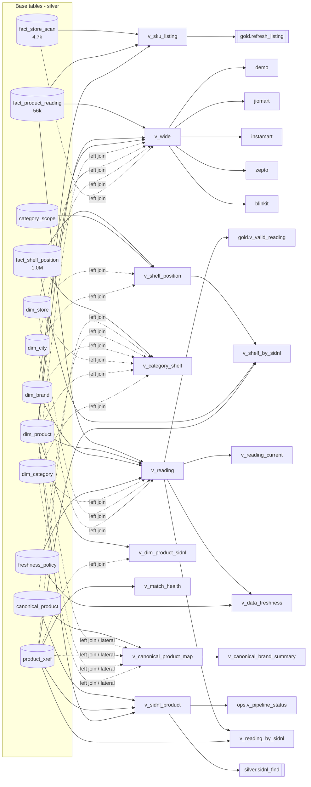

# Silver schema — view audit (read-only)

> **Current-state note (2026-11-09):** this catalog below records the earlier
> 19-view state, before live migrations 051–055. The confirmed current schema
> has 16 Silver views. `v_shelf_position` exposes `product_key`, and
> `v_shelf_by_sidnl` is built from it. `v_category_shelf`,
> `v_dim_product_sidnl`, and `demo` have been dropped. `dim_date` has also
> been dropped. All current views use `security_invoker`; operational and
> pipeline bookkeeping views live in `ops`. The old detailed descriptions and
> counts below are historical evidence, not the current inventory.

**Date:** 2026-11-09 · **Database:** Supabase project `SIDNL` (`jqxnaqbvwgmfkyzfincy`, Postgres 17)
**Method:** live catalog only — `pg_get_viewdef`, `pg_depend`, `pg_class.reloptions`, `information_schema.role_table_grants`, `count(*)` per view. Purposes were taken from the SQL, not from the names. **Nothing was created, changed or dropped.**

Reference for "which metrics": *Business Analytics Metrics & Formulas* PDF (DOC-20261106-WA0007), plus the live table `silver.ref_metric_support`, which already maps each PDF metric (55 rows) to its silver source.

---

## 1. At a glance

The `silver` schema has **19 views**. **All are normal views. None are materialized**, so each one re-runs its SQL on every query and always shows the current table data.

| # | View | Category | Rows now | Reads from | `security_invoker` | Used by |
|---|---|---|---:|---|:-:|---|
| 1 | `v_reading` | Reading | 56,249 | 7 tables | **no** | `v_reading_current`, `v_reading_by_sidnl`, `v_data_freshness`, `gold.v_valid_reading` |
| 2 | `v_reading_current` | Reading | 37,815 | `v_reading` | **no** | docs / metric catalog (FE inventory) |
| 3 | `v_reading_by_sidnl` | Reading + Mapping | 56,249 | `v_reading`, `product_xref` | yes | README / docs (query by SI id) |
| 4 | `v_wide` | Reporting (compat) | 56,249 | 7 tables | **no** | the 5 platform views |
| 5–9 | `blinkit`, `zepto`, `instamart`, `jiomart`, `demo` | Reporting (compat) | 55,905 / 344 / 0 / 0 / 0 | `v_wide` | **no** | RAG app, `sql/gold/002_gold_base_union.sql` |
| 10 | `v_shelf_position` | Shelf | 1,006,016 | 4 tables | yes | `v_shelf_by_sidnl` |
| 11 | `v_shelf_by_sidnl` | Shelf + Mapping | 1,006,016 | `v_shelf_position`, 2 tables | yes | README / docs |
| 12 | `v_category_shelf` | Shelf + Mapping | ≈1,006,016 | 7 tables | yes | nothing found |
| 13 | `v_sku_listing` | Reporting (metric) | 474 | 3 tables | **no** | `gold.refresh_listing()`, `sidnl/silver.py` |
| 14 | `v_canonical_product_map` | Product + Mapping | 3,533 | 5 tables | yes | `v_canonical_brand_summary` |
| 15 | `v_canonical_brand_summary` | Product (brand) | 546 | `v_canonical_product_map` | yes | docs |
| 16 | `v_sidnl_product` | Product + Mapping | 3,533 | 3 tables | yes | `silver.sidnl_find()`, `ops.v_pipeline_status` |
| 17 | `v_dim_product_sidnl` | Mapping | 3,540 | 2 tables | yes | nothing found |
| 18 | `v_match_health` | Monitoring / DQ | 3 | `product_xref` | yes | docs |
| 19 | `v_data_freshness` | Monitoring / DQ | 6 | `v_reading`, `freshness_policy` | **no** | docs |

Nothing outside the owner has grants on any silver view (`role_table_grants` returned no rows for `anon`, `authenticated` or `service_role`). Today the views are reachable only by the owner and by functions.

---

## 2. Dependency diagram



Solid arrow = inner join (a missing match drops the row). Dotted arrow = left join (a missing match leaves NULLs). `[[ ]]` = function.

**Views built on other views** (if a view on the left changes, everything to its right changes too):

```
v_reading ─┬─ v_reading_current
           ├─ v_reading_by_sidnl
           ├─ v_data_freshness
           └─ gold.v_valid_reading
v_wide ──── blinkit, zepto, instamart, jiomart, demo
v_shelf_position ── v_shelf_by_sidnl
v_canonical_product_map ── v_canonical_brand_summary
v_sidnl_product ── silver.sidnl_find(), ops.v_pipeline_status
v_sku_listing ── gold.refresh_listing()
```

---

## 3. Base tables the views read from

| Table | Rows (est.) | What one row is |
|---|---:|---|
| `fact_product_reading` | 56,249 | One product read at one dark store at one time. `source_type` ∈ `stock_check` (7,370), `brand_search` (8,058), `category_shelf` (40,821). |
| `fact_shelf_position` | 1,006,016 (420 MB) | One product card at one position on a scoped category shelf, **all brands** (market-wide). |
| `fact_store_scan` | 4,754 | One brand-search scan of one store. `is_valid_denominator` marks the scans that count as "eligible stores". |
| `dim_product` | 3,540 | One (platform, platform product id) of a tracked brand. |
| `dim_brand` | 546 | Tracked brands. |
| `dim_category` | small | Platform L1 > L2 > L3 category tree. |
| `dim_store` | 1,136 | Dark stores. |
| `dim_city` | 11 | Cities covered. |
| `freshness_policy` | 3 | Hours before a reading is stale: stock_check 48 h, brand_search 24 h, category_shelf 72 h. |
| `category_scope` | 6 | The category shelves loaded market-wide. |
| `canonical_product` | 3,533 | One real-world product (the **SI id**, `sidnl_id`). |
| `product_xref` | 3,540 | `dim_product` → SI id, with match status, method and score. One row per `product_key` (verified: no duplicates). |

---

## 4. View-by-view audit

Every view below is a **normal view, always up to date**: the data changes as soon as the underlying tables change. Nothing needs refreshing.

### 4.1 `v_reading` — Reading view (base for analytics)

**Business purpose.** One row for every product reading. Each row carries the product, brand, category, store, city, price, stock and ad flags, plus two computed fields: how old the reading is (`age_hours`) and whether it is still `fresh` or already `stale` under `freshness_policy`. It keeps every data-quality status, so metric queries must filter `dq_status = 'valid'`.

**Use:** analytics / reporting base (OSA, price, discount, assortment), and the input to monitoring (`v_data_freshness`).

**SQL**
```sql
SELECT f.reading_key, f.source_type, f.source_record_id, f.job_ref, f.observed_at, f.obs_date,
       p.platform, b.brand_key, b.brand_name, b.company_name,
       p.product_key, p.platform_product_id, p.product_name, p.variant, p.product_type,
       p.pack_raw, p.size_value, p.size_unit, p.pack_count,
       c.l1_id, c.l1_name AS l1_category, c.l2_id, c.l2_name AS l2_category,
       c.l3_id, c.l3_name AS l3_category, c.category_path,
       s.store_key, s.source_store_id, s.store_external_id, s.store_name,
       f.city_slug, ct.city_name, ct.state, s.latitude, s.longitude,
       f.stock_status, f.is_listed, f.is_available, f.inventory_units, f.inventory_is_capped,
       f.selling_price, f.mrp, f.discount_amount, f.discount_pct,
       f.search_position, f.organic_position, f.is_ad, f.ad_type,
       f.osa_eligible, f.dq_status, f.dq_flags,
       round(EXTRACT(epoch FROM now() - f.observed_at) / 3600, 1) AS age_hours,
       CASE WHEN f.observed_at >= now() - make_interval(hours => fp.fresh_within_hours)
            THEN 'fresh' ELSE 'stale' END AS freshness
FROM silver.fact_product_reading f
JOIN silver.dim_product      p  ON p.product_key  = f.product_key
JOIN silver.dim_brand        b  ON b.brand_key    = p.brand_key
JOIN silver.freshness_policy fp ON fp.source_type = f.source_type
LEFT JOIN silver.dim_category c  ON c.category_key = p.category_key
LEFT JOIN silver.dim_store    s  ON s.store_key    = f.store_key
LEFT JOIN silver.dim_city     ct ON ct.city_slug   = f.city_slug;
```

**Joins**
| Join | Type | Meaning |
|---|---|---|
| fact → `dim_product` on `product_key` | INNER | each reading's product |
| product → `dim_brand` on `brand_key` | INNER | brand. A product without a brand row drops out. |
| fact → `freshness_policy` on `source_type` | INNER | stale threshold. **A source_type missing from the policy drops out.** |
| product → `dim_category` | LEFT | category can be NULL |
| fact → `dim_store` | LEFT | store can be NULL (unresolved store) |
| fact → `dim_city` on `city_slug` | LEFT | city name/state |

Today no rows are lost: `count(v_reading)` = `count(fact_product_reading)` = 56,249.

**Columns**
| Group | Columns | Meaning |
|---|---|---|
| Reading identity | `reading_key`, `source_type`, `source_record_id`, `job_ref`, `observed_at`, `obs_date` | Surrogate key; which scraper produced it (`stock_check`/`brand_search`/`category_shelf`); the bronze row id; scrape job reference; timestamp and date seen. |
| Platform & brand | `platform`, `brand_key`, `brand_name`, `company_name` | Platform (blinkit, zepto, …); brand key, display name and owning company. |
| Product | `product_key`, `platform_product_id`, `product_name`, `variant`, `product_type`, `pack_raw`, `size_value`, `size_unit`, `pack_count` | Silver product key; the platform's own id; name; variant (flavour etc.); type; raw pack text and its parsed size / unit / multipack count. |
| Category | `l1_id`, `l1_category`, `l2_id`, `l2_category`, `l3_id`, `l3_category`, `category_path` | Platform category ids and names at each level, and the full "L1 > L2 > L3" path. |
| Store & geography | `store_key`, `source_store_id`, `store_external_id`, `store_name`, `city_slug`, `city_name`, `state`, `latitude`, `longitude` | Dark store (silver key, scraper id, platform id, name) and where it is. |
| Availability | `stock_status`, `is_listed`, `is_available`, `inventory_units`, `inventory_is_capped`, `osa_eligible` | Raw stock text; listed in the store; in stock; units shown (FE inventory); TRUE when the platform caps the displayed number; TRUE when the row counts toward OSA (product-page stock checks only). |
| Price | `selling_price`, `mrp`, `discount_amount`, `discount_pct` | SP, MRP, MRP − SP, (MRP − SP)/MRP × 100 (NULL if MRP is 0 or missing). |
| Visibility | `search_position`, `organic_position`, `is_ad`, `ad_type` | Rank on the page; rank ignoring ads; sponsored flag and ad type. |
| Data quality | `dq_status`, `dq_flags` | `valid` or a failure status; array of rule codes that fired. |
| Computed | `age_hours`, `freshness` | Hours since `observed_at` (now() at query time); `fresh`/`stale` per `freshness_policy`. |

---

### 4.2 `v_reading_current` — Reading view (latest snapshot)

**Business purpose.** The current picture: for each (product, store) pair, the single newest **valid** reading from any source. It answers "what is FE inventory / price / availability right now in each store?". Old readings are hidden, but a "current" row can still be stale, so check `freshness`.

**Use:** reporting / application queries (FE inventory, critical SKUs, PSL proxy).

**SQL**
```sql
SELECT DISTINCT ON (product_key, store_key) <all 54 v_reading columns, same order>
FROM silver.v_reading r
WHERE dq_status = 'valid' AND store_key IS NOT NULL
ORDER BY product_key, store_key, observed_at DESC, reading_key DESC;
```
**Depends on:** `v_reading` (and through it the 7 tables). No joins of its own.
**Logic:** keeps valid rows that have a store, then keeps the latest per product × store. `reading_key DESC` breaks ties at the same timestamp.
**Columns:** identical to `v_reading`.
**Note:** it recomputes `now()`-based columns for all 56k rows before deduplicating. That is fine at this size. Consider an index on `fact_product_reading (product_key, store_key, observed_at DESC)` or a materialized table if the data grows 10×.

---

### 4.3 `v_reading_by_sidnl` — Reading + Mapping view

**Business purpose.** The same readings as `v_reading`, with the **SI id** attached. Filter by `sidnl_id` to follow one real product across Blinkit, Zepto and other platforms, for example for price parity.

**Use:** application queries / analytics (cross-platform comparison).

**SQL**
```sql
SELECT x.sidnl_id, r.<all 54 v_reading columns>
FROM silver.product_xref x
JOIN silver.v_reading r ON r.product_key = x.product_key;
```
**Depends on:** `product_xref`, view `v_reading`.
**Join:** INNER on `product_key`. Readings whose product has no xref row are dropped. Today none are (56,249 = 56,249).
**Columns:** `sidnl_id` (canonical product id) + every `v_reading` column.
**Security:** `security_invoker=true`, but it reads `v_reading`, which is **not** invoker. The inner view still runs with the owner's rights.

---

### 4.4 `v_wide` — Reporting / compatibility view

**Business purpose.** It reshapes the star schema (`fact_product_reading` + dimensions) into the old flat "one wide row per scrape" layout that the gold SQL and the RAG chatbot were written against. It adds no business data. It only renames columns, adds constants and fills placeholder NULLs.

**Use:** reporting / downstream compatibility.

**SQL (key parts)**
```sql
SELECT f.reading_key AS id, p.platform,
       CASE f.source_type WHEN 'stock_check' THEN 'observation' ELSE 'shelf_position' END AS source_type,
       f.source_record_id, p.listing_id, p.catalog_product_id AS product_id, s.source_store_id AS store_id,
       f.run_id, f.scrape_id AS scrape_run_id,
       c.l1_id, c.l1_name AS l1_category, c.l2_id, c.l2_name AS l2_category, c.l3_id, c.l3_name AS l3_category, c.category_path,
       p.platform_product_id, p.platform_product_id AS sku_code, p.product_name, p.product_name AS sku_name,
       b.brand_name AS brand, p.variant, NULL::text AS product_description, p.product_url, p.image_url,
       p.pack_raw AS pack_size, p.size_unit AS pack_unit, p.size_value AS quantity, p.size_unit AS quantity_unit,
       f.mrp, f.selling_price AS sale_price, f.discount_amount, f.discount_pct AS discount_percentage,
       round(f.selling_price / NULLIF(p.total_content, 0), 4) AS price_per_unit, 'INR' AS currency,
       f.inventory_units AS inventory, f.inventory_is_capped AS inventory_capped, f.inventory_units AS available_quantity,
       f.is_available AS availability, f.stock_status,
       CASE WHEN f.inventory_units IS NULL THEN NULL WHEN f.inventory_is_capped THEN 'capped' ELSE 'exact' END AS inventory_status,
       NULL::int AS delivery_eta_minutes, f.search_position AS "position", f.organic_position, f.is_ad, f.ad_type, p.product_type,
       s.store_external_id, s.store_name, ct.city_name AS city, f.city_slug, ct.state, NULL AS pincode, s.latitude, s.longitude,
       f.observed_at, f.observed_at AS scraped_at, f.loaded_at AS transformed_at, NULL AS source_url,
       sc.scan_status AS scrape_status, NULL AS scrape_backend, NULL AS scrape_run_status,
       f.dq_status AS data_quality_status, to_jsonb(f.dq_flags) AS validation_errors, NULL::jsonb AS raw_details,
       jsonb_build_object('source_type', f.source_type, 'source_table', f.source_table,
                          'job_ref', f.job_ref, 'etl_run_id', f.etl_run_id) AS source_metadata,
       ARRAY[f.source_record_id] AS bronze_record_ids
FROM silver.fact_product_reading f
JOIN silver.dim_product p ON p.product_key = f.product_key
JOIN silver.dim_brand   b ON b.brand_key   = p.brand_key
LEFT JOIN silver.dim_category c ON c.category_key = p.category_key
LEFT JOIN silver.dim_store s    ON s.store_key = f.store_key
LEFT JOIN silver.dim_city ct    ON ct.city_slug = f.city_slug
LEFT JOIN silver.fact_store_scan sc ON sc.snapshot_id = f.snapshot_id AND f.source_type = 'brand_search';
```

**Joins:** the same as `v_reading`, except there is **no** `freshness_policy` join, and there is an extra LEFT join to `fact_store_scan` (brand-search rows only) to get the scan status.

**Columns:** 67 columns. All of them are renames of `v_reading`-type fields, except:
- **Always NULL placeholders** (kept for contract shape only): `product_description`, `delivery_eta_minutes`, `pincode`, `source_url`, `scrape_backend`, `scrape_run_status`, `raw_details`.
- **Duplicates of another column:** `sku_code` = `platform_product_id`; `sku_name` = `product_name`; `available_quantity` = `inventory`; `scraped_at` = `observed_at`; `pack_unit` = `quantity_unit`.
- **Computed:** `price_per_unit` (SP ÷ total pack content), `currency` (always `INR`), `inventory_status` (`capped`/`exact`/NULL), `source_metadata` (lineage JSON), `bronze_record_ids` (one-element array).

**Caveat:** `source_type` maps **both** `brand_search` and `category_shelf` to `'shelf_position'`. Only `stock_check` becomes `'observation'`. Consumers cannot tell brand-search rows from category-shelf rows without reading `source_metadata->>'source_type'`.

---

### 4.5–4.9 `blinkit`, `zepto`, `instamart`, `jiomart`, `demo` — Reporting / compatibility

**Business purpose.** Per-platform slices of `v_wide` that keep the old bronze-era table names working.

```sql
SELECT <all 67 v_wide columns> FROM silver.v_wide WHERE platform = '<platform>';
```

| View | Rows | Comment in DB |
|---|---:|---|
| `blinkit` | 55,905 | compat contract for gold/RAG |
| `zepto` | 344 | 〃 |
| `instamart` | 0 | 〃 (no data loaded yet) |
| `jiomart` | 0 | 〃 (no data loaded yet) |
| `demo` | 0 | **always empty by design**: demo data never enters silver |

**Depends on:** `v_wide` only. **Columns:** identical to `v_wide`. **Use:** reporting compatibility (RAG `Rag/sql/01_views.sql`, `sql/gold/002_gold_base_union.sql`).
**Overlap:** these five are fully redundant with `v_wide WHERE platform = …`.

---

### 4.10 `v_shelf_position` — Shelf view

**Business purpose.** Every product card seen on a **scoped category shelf**, for all brands and competitors, with category, store and city names added. It is the market-wide denominator for SOV, top-of-search SOV, category impression share and competitor price/discount.

**Use:** analytics (visibility / competition).

**SQL**
```sql
SELECT f.shelf_pos_key, f.source_record_id, f.snapshot_id, f.platform, f.l1_id, f.l2_id,
       f.store_key, f.city_slug, f.observed_at, f.obs_date,
       f.shelf_position, f.organic_position, f.is_ad, f.ad_type,
       f.brand_raw, f.brand_key, f.is_client_brand,
       f.platform_product_id, f.product_name, f.pack_raw,
       f.stock_status, f.inventory_units, f.inventory_is_capped,
       f.selling_price, f.mrp, f.discount_pct,
       f.shelf_cards_seen, f.shelf_total_items, f.shelf_complete,
       f.dq_status, f.dq_flags, f.loaded_at, f.etl_run_id,
       cs.l1_name, cs.l2_name, (cs.l1_name || ' > ') || cs.l2_name AS category_path,
       ds.store_name, ct.city_name
FROM silver.fact_shelf_position f
JOIN silver.category_scope cs ON cs.platform = f.platform AND cs.l1_id = f.l1_id AND cs.l2_id = f.l2_id
LEFT JOIN silver.dim_store ds ON ds.store_key = f.store_key
LEFT JOIN silver.dim_city  ct ON ct.city_slug = f.city_slug;
```

**Joins:** INNER to `category_scope` on (platform, l1_id, l2_id): only shelves still in scope are shown. **If a scope row is deleted, its history disappears from this view.** Today there are 0 unscoped rows. LEFT to store and city for names.

**Columns**
| Group | Columns | Meaning |
|---|---|---|
| Identity | `shelf_pos_key`, `source_record_id`, `snapshot_id`, `etl_run_id`, `loaded_at` | Key; bronze row; one shelf read; ETL run; load time. |
| Where/when | `platform`, `l1_id`, `l2_id`, `l1_name`, `l2_name`, `category_path`, `store_key`, `store_name`, `city_slug`, `city_name`, `observed_at`, `obs_date` | Which shelf, store and city, and when. `category_path` here is **L1 > L2 only**, built from `category_scope`. |
| Position | `shelf_position`, `organic_position`, `is_ad`, `ad_type` | Card rank, rank ignoring ads, sponsored flag. Each row is one "impression" for SOV. |
| Brand | `brand_raw`, `brand_key`, `is_client_brand` | Brand text as scraped; the client brand key when matched, else normalised text; TRUE when it is a tracked brand. |
| Product | `platform_product_id`, `product_name`, `pack_raw` | The card's product. **`product_key` is not exposed.** |
| Stock & price | `stock_status`, `inventory_units`, `inventory_is_capped`, `selling_price`, `mrp`, `discount_pct` | As on the card (competitor price/discount). |
| Shelf depth | `shelf_cards_seen`, `shelf_total_items`, `shelf_complete` | How many cards the scraper read vs how many the shelf has. FALSE = only the top was captured. |
| DQ | `dq_status`, `dq_flags` | As in readings. |

---

### 4.11 `v_shelf_by_sidnl` — Shelf + Mapping view

**Business purpose.** The category-shelf positions of products, keyed by SI id, so you can ask "where does product SI-xxxx sit on the shelf across platforms?". It is the shelf companion of `v_reading_by_sidnl`.

**SQL**
```sql
SELECT x.sidnl_id, v.<all 38 v_shelf_position columns>
FROM silver.fact_shelf_position fs
JOIN silver.product_xref x       ON x.product_key = fs.product_key
JOIN silver.v_shelf_position v   ON v.shelf_pos_key = fs.shelf_pos_key;
```
**Depends on:** `fact_shelf_position`, `product_xref`, view `v_shelf_position`.
**Joins:** `fact_shelf_position` is read **twice**: once directly, only to get `product_key` for the xref join, and once inside `v_shelf_position`. That is an extra join of a 1 M-row / 420 MB table to itself. All three joins are INNER, so cards without an SI id and unscoped shelves are dropped.
**Columns:** `sidnl_id` + every `v_shelf_position` column.
**Source:** uncommitted migration `live/20261109060100_silver_046_v_shelf_by_sidnl.sql`.

---

### 4.12 `v_category_shelf` — Shelf + Mapping view (older)

**Business purpose.** Category shelf readings for all brands with the SI id, canonical name, brand name, full category path and store. It answers the same question as `v_shelf_by_sidnl`, with different joins.

**SQL**
```sql
SELECT x.sidnl_id, c.canonical_name, f.platform, f.brand_key, b.brand_name, dc.category_path,
       f.product_key, f.platform_product_id, f.product_name, f.pack_raw,
       ds.city_slug, ds.store_name, f.observed_at, f.obs_date,
       f.shelf_position, f.organic_position, f.is_ad, f.ad_type,
       f.stock_status, f.inventory_units, f.inventory_is_capped,
       f.selling_price, f.mrp, f.discount_pct, f.shelf_complete, f.dq_status
FROM silver.fact_shelf_position f
LEFT JOIN silver.product_xref x      ON x.product_key = f.product_key
LEFT JOIN silver.canonical_product c ON c.sidnl_id = x.sidnl_id
LEFT JOIN silver.dim_brand b         ON b.brand_key = f.brand_key
LEFT JOIN silver.dim_store ds        ON ds.store_key = f.store_key
LEFT JOIN silver.dim_product dp      ON dp.product_key = f.product_key
LEFT JOIN silver.dim_category dc     ON dc.category_key = dp.category_key;
```
**Joins:** all LEFT, so no row is ever dropped. Category comes from `dim_category` via the product (L1 > L2 > L3), not from `category_scope`.
**Columns (26):** `sidnl_id`, `canonical_name` (SI product name), `brand_name`, `category_path` (full L3 path), `product_key`, and a subset of the shelf fields above. `city_slug` comes from the **store**, not from the fact row. It has no `shelf_cards_seen` / `shelf_total_items` / `dq_flags` / `is_client_brand`.
**Used by:** no view, function or repo code references it. **Source:** `sql/silver/026_category_pipeline.sql`.

---

### 4.13 `v_sku_listing` — Reporting / metric view

**Business purpose.** Implements the PDF metric **Dark-store listing %** per SKU × city, plus an `ALL` city roll-up: `listing_pct = stores listing the SKU ÷ eligible stores × 100`. It uses the latest valid brand-search scan of every store.

**Use:** reporting. `gold.refresh_listing()` copies it into gold, and `sidnl/silver.py` shows it in the CLI.

**SQL**
```sql
WITH latest_scan AS (            -- newest valid scan per brand x store
  SELECT DISTINCT ON (s.brand_key, s.store_key) s.brand_key, s.store_key, s.snapshot_id, s.platform,
         s.scanned_at, s.stopped_early, COALESCE(s.city_slug, '(unknown)') AS city_slug
  FROM silver.fact_store_scan s WHERE s.is_valid_denominator
  ORDER BY s.brand_key, s.store_key, s.scanned_at DESC, s.snapshot_id DESC),
eligible AS (                    -- denominator, per city and ROLLUP 'ALL'
  SELECT platform, brand_key, COALESCE(city_slug, 'ALL') AS city_slug, count(*) AS eligible_stores,
         count(*) FILTER (WHERE stopped_early) AS eligible_stores_stopped_early, max(scanned_at) AS latest_scan_at
  FROM latest_scan GROUP BY platform, brand_key, ROLLUP(city_slug)),
listed AS (                      -- numerator: stores whose latest scan saw the SKU
  SELECT ls.platform, ls.brand_key, COALESCE(ls.city_slug, 'ALL') AS city_slug, f.product_key,
         count(DISTINCT ls.store_key) AS listing_stores
  FROM latest_scan ls
  JOIN silver.fact_product_reading f ON f.snapshot_id = ls.snapshot_id
       AND f.source_type = 'brand_search' AND f.dq_status = 'valid' AND f.is_listed
  GROUP BY ls.platform, ls.brand_key, f.product_key, ROLLUP(ls.city_slug))
SELECT p.platform, p.brand_key, p.product_key, p.platform_product_id, p.product_name,
       e.city_slug, e.eligible_stores, COALESCE(l.listing_stores, 0) AS listing_stores,
       round(100.0 * COALESCE(l.listing_stores, 0) / NULLIF(e.eligible_stores, 0), 2) AS listing_pct,
       e.eligible_stores_stopped_early, e.latest_scan_at
FROM silver.dim_product p
JOIN eligible e ON e.platform = p.platform AND e.brand_key = p.brand_key
LEFT JOIN listed l ON l.product_key = p.product_key AND l.city_slug = e.city_slug;
```
**Joins:** each product → every city row of its brand's denominator (INNER). LEFT join to the numerator means a SKU seen nowhere shows `0`, not "missing".
**Columns:** `platform`, `brand_key`, `product_key`, `platform_product_id`, `product_name`; `city_slug` (a city, `(unknown)`, or `ALL`); `eligible_stores` (denominator); `listing_stores` (numerator); `listing_pct`; `eligible_stores_stopped_early` (denominator stores whose scan stopped before the end); `latest_scan_at`.

---

### 4.14 `v_canonical_product_map` — Product + Mapping view

**Business purpose.** A human-readable product master: one row per active real-world product (SI id). It shows brand, canonical name, size, display categories, which platforms carry it and under which ids, an image, first/last seen dates, and whether any mapping still needs review.

**Use:** application queries / reporting (product catalogue).

**SQL**
```sql
SELECT c.sidnl_id, COALESCE(b.brand_name, c.brand_key) AS brand, c.canonical_name AS product_name,
       c.variant, c.product_type, trim_scale(c.size_value) AS size_value, c.size_unit, c.pack_count,
       cat.l1_name AS category_l1, cat.l2_name AS category_l2, cat.l3_name AS category_l3,
       m.platforms, m.platform_count, m.platform_ids, m.listings AS platform_listings,
       m.image_url, m.first_seen_at, m.last_seen_at, m.needs_review
FROM silver.canonical_product c
LEFT JOIN silver.dim_brand b ON b.brand_key = c.brand_key
LEFT JOIN LATERAL (                         -- all platform listings of this SI id
   SELECT array_agg(DISTINCT d.platform ORDER BY d.platform) AS platforms,
          count(DISTINCT d.platform) AS platform_count, count(*) AS listings,
          (SELECT jsonb_object_agg(z.platform, z.ids) FROM (
               SELECT d2.platform, to_jsonb(array_agg(d2.platform_product_id ORDER BY d2.platform_product_id)) AS ids
               FROM silver.product_xref x2 JOIN silver.dim_product d2 ON d2.product_key = x2.product_key
               WHERE x2.sidnl_id = c.sidnl_id GROUP BY d2.platform) z) AS platform_ids,
          (array_agg(d.image_url ORDER BY d.image_url IS NULL, d.product_key))[1] AS image_url,
          min(d.first_seen_at) AS first_seen_at, max(d.last_seen_at) AS last_seen_at,
          bool_or(x.match_status = 'PENDING_REVIEW') AS needs_review
   FROM silver.product_xref x JOIN silver.dim_product d ON d.product_key = x.product_key
   WHERE x.sidnl_id = c.sidnl_id) m ON true
LEFT JOIN LATERAL (                         -- best-filled category among its listings
   SELECT dc.l1_name, dc.l2_name, dc.l3_name
   FROM silver.product_xref x JOIN silver.dim_product d ON d.product_key = x.product_key
   JOIN silver.dim_category dc ON dc.category_key = d.category_key
   WHERE x.sidnl_id = c.sidnl_id
   ORDER BY dc.l3_name IS NOT NULL DESC, dc.l2_name IS NOT NULL DESC, d.product_key LIMIT 1) cat ON true
WHERE c.is_active;
```
**Joins:** LEFT to brand (falls back to the brand key). Two LATERAL subqueries run per SI id: (1) aggregate all linked `dim_product` rows through `product_xref`; (2) pick the most complete category among those listings.
**Columns:** `sidnl_id`; `brand`; `product_name` (canonical); `variant`, `product_type`, `size_value` (trailing zeros trimmed), `size_unit`, `pack_count`; `category_l1/l2/l3` (**from the platform category tree**); `platforms` (text array); `platform_count`; `platform_ids` (JSON `{platform: [ids…]}`); `platform_listings` (number of listings); `image_url` (first non-null); `first_seen_at`, `last_seen_at`; `needs_review` (TRUE if any listing is `PENDING_REVIEW`).

### 4.15 `v_canonical_brand_summary` — Product (brand level)

**Business purpose.** One row per brand: how many real products it has and how well they are mapped. It exists because the product map repeats the brand once per SKU.

```sql
SELECT brand, count(*) AS products, sum(platform_listings) AS platform_listings,
       count(*) FILTER (WHERE platform_count > 1)     AS on_multiple_platforms,
       count(*) FILTER (WHERE category_l3 IS NOT NULL) AS with_l3_category,
       count(*) FILTER (WHERE needs_review)           AS needing_review
FROM silver.v_canonical_product_map GROUP BY brand;
```
**Depends on:** view `v_canonical_product_map`. **Use:** reporting + data-quality. **Columns:** as named in the SQL above.

---

### 4.16 `v_sidnl_product` — Product + Mapping view (lookup)

**Business purpose.** One row per active SI id with its canonical attributes and the product id on every platform. `platform_ids` holds one primary id per platform and `platform_id_aliases` holds all ids. It is the lookup behind `silver.sidnl_find()` and `ops.v_pipeline_status`.

**Use:** application queries + operational.

**SQL**
```sql
WITH mem AS (SELECT c.sidnl_id, d.platform, d.platform_product_id, d.product_key, d.first_seen_at, d.last_seen_at, x.match_status
             FROM silver.canonical_product c
             JOIN silver.product_xref x ON x.sidnl_id = c.sidnl_id
             JOIN silver.dim_product  d ON d.product_key = x.product_key
             WHERE c.is_active),
per AS (SELECT sidnl_id, platform, min(platform_product_id) AS primary_id,
               to_jsonb(array_agg(platform_product_id ORDER BY platform_product_id)) AS all_ids
        FROM mem GROUP BY sidnl_id, platform),
pj  AS (SELECT sidnl_id, jsonb_object_agg(platform, primary_id) AS platform_ids,
               jsonb_object_agg(platform, all_ids) AS platform_id_aliases FROM per GROUP BY sidnl_id),
agg AS (SELECT sidnl_id, count(*) AS products, count(DISTINCT platform) AS platform_count,
               array_agg(product_key ORDER BY platform, product_key) AS product_keys,
               bool_or(match_status = 'PENDING_REVIEW') AS needs_review,
               min(first_seen_at) AS first_seen_at, max(last_seen_at) AS last_seen_at
        FROM mem GROUP BY sidnl_id)
SELECT c.sidnl_id, c.brand_key, c.canonical_name, c.variant, c.size_value, c.size_unit, c.pack_count,
       c.category_l1, c.category_l2, c.category_l3,
       a.products, a.platform_count, pj.platform_ids, a.product_keys, a.needs_review,
       a.first_seen_at, a.last_seen_at, pj.platform_id_aliases
FROM silver.canonical_product c
JOIN agg a ON a.sidnl_id = c.sidnl_id
JOIN pj    ON pj.sidnl_id = c.sidnl_id
WHERE c.is_active;
```
**Joins:** INNER throughout. An SI id with no linked listing is omitted.
**Columns:** canonical fields (category from **`canonical_product.category_l1..l3`**); `products` (listing count); `platform_count`; `platform_ids` (JSON one id per platform); `product_keys` (array); `needs_review`; `first_seen_at`, `last_seen_at`; `platform_id_aliases` (JSON all ids per platform).

### 4.17 `v_dim_product_sidnl` — Mapping view

**Business purpose.** Every platform listing (`dim_product`) with its SI id and how it was matched. One row per listing, including any listing not yet mapped (`sidnl_id` NULL).

```sql
SELECT x.sidnl_id, x.match_status, x.match_method, x.score,
       d.product_key, d.platform, d.platform_product_id, d.brand_key, d.product_name, d.variant, d.product_type,
       d.pack_raw, d.size_value, d.size_unit, d.pack_count, d.total_content, d.category_key,
       d.listing_id, d.catalog_product_id, d.image_url, d.product_url, d.first_seen_at, d.last_seen_at
FROM silver.dim_product d
LEFT JOIN silver.product_xref x ON x.product_key = d.product_key;
```
**Use:** data processing / debugging the matcher. **Columns:** match fields (`sidnl_id`, `match_status`, `match_method`, `score`) + every `dim_product` column. **Used by:** nothing found in the DB or the repo.

### 4.18 `v_match_health` — Monitoring / data-quality

**Business purpose.** How products were mapped to SI ids: counts and score statistics per status × method. Watch `PENDING_REVIEW` and `min_score`.

```sql
SELECT match_status, match_method, count(*) AS products,
       round(avg(score), 3) AS avg_score, round(min(score), 3) AS min_score,
       count(DISTINCT sidnl_id) AS si_ids
FROM silver.product_xref x GROUP BY match_status, match_method;
```
**Columns:** `match_status`, `match_method`, `products` (listings), `avg_score`, `min_score`, `si_ids` (distinct SI ids). 3 rows today.

### 4.19 `v_data_freshness` — Monitoring / data-quality

**Business purpose.** For each platform × brand × source: how many readings exist, how many are fresh vs stale, when the last one arrived, and whether the source as a whole is still `fresh`.

```sql
SELECT r.platform, r.brand_key, r.source_type, count(*) AS readings,
       count(*) FILTER (WHERE r.freshness = 'fresh') AS fresh_readings,
       count(*) FILTER (WHERE r.freshness = 'stale') AS stale_readings,
       round(100.0 * count(*) FILTER (WHERE r.freshness = 'fresh') / count(*), 1) AS pct_fresh,
       min(r.observed_at) AS first_observed_at, max(r.observed_at) AS last_observed_at,
       round(EXTRACT(epoch FROM now() - max(r.observed_at)) / 3600, 1) AS hours_since_last_reading,
       fp.fresh_within_hours,
       CASE WHEN max(r.observed_at) >= now() - make_interval(hours => fp.fresh_within_hours)
            THEN 'fresh' ELSE 'stale' END AS source_status
FROM silver.v_reading r
JOIN silver.freshness_policy fp ON fp.source_type = r.source_type
GROUP BY r.platform, r.brand_key, r.source_type, fp.fresh_within_hours;
```
**Depends on:** view `v_reading` + `freshness_policy`. The policy is joined twice (once inside `v_reading`); this is harmless. **Columns:** as named. Note that it counts **all** `dq_status` values, not only valid ones. 6 rows today.

---

## 5. Logical categories

| Category | Views |
|---|---|
| **Product views** | `v_canonical_product_map`, `v_sidnl_product`, `v_canonical_brand_summary` |
| **Reading views** | `v_reading`, `v_reading_current`, `v_reading_by_sidnl` |
| **Shelf views** | `v_shelf_position`, `v_shelf_by_sidnl`, `v_category_shelf` |
| **Mapping views** | `v_dim_product_sidnl`, plus the SI-id joins in `v_reading_by_sidnl`, `v_shelf_by_sidnl`, `v_sidnl_product` |
| **Reporting views** | `v_sku_listing` (listing % metric), `v_wide`, `blinkit`, `zepto`, `instamart`, `jiomart`, `demo` (compat) |
| **Monitoring & data-quality** | `v_match_health`, `v_data_freshness`, (`v_canonical_brand_summary.needing_review`) |

The ops-type views that older repo migrations created in `silver` (`v_dq_summary`, `v_pipeline_status`, `v_quality_latest`, `v_storage_projection`, `v_cron_health`) now live in the **`ops`** schema, not `silver` (see the uncommitted `048_move_pipeline_logs_to_ops`).

---

## 6. Duplicate and overlapping views

| Overlap | What is the same | What differs | Suggestion (not applied) |
|---|---|---|---|
| `v_wide` ↔ `v_reading` | Same fact + dimension joins, same rows (56,249) | `v_wide` renames to the legacy contract, adds NULL placeholders and scan status, and has no freshness | Keep `v_reading` as the source of truth. Keep `v_wide` only while gold/RAG need the old contract. |
| `blinkit/zepto/instamart/jiomart/demo` ↔ `v_wide` | 100 % subset by `platform` | nothing | 5 views can become one filter. `demo` is always empty. |
| `v_shelf_by_sidnl` ↔ `v_category_shelf` | Both are "shelf rows + SI id", ≈1 M rows | `v_category_shelf`: all LEFT joins, full L3 path, `canonical_name`, `product_key`. `v_shelf_by_sidnl`: INNER joins, scope L1>L2 path, shelf-depth/DQ columns, double scan of the fact table | Pick one. `v_category_shelf` has no consumers. |
| `v_sidnl_product` ↔ `v_canonical_product_map` | Both are one row per active SI id with platform ids, first/last seen, `needs_review` (3,533 each) | Category source differs (`canonical_product.category_*` vs best `dim_category` of listings), so the two **can disagree**. The map adds brand name and image; the lookup adds `product_keys` and aliases. | Decide which category is authoritative and document it. |
| `v_dim_product_sidnl` ↔ `v_sidnl_product` | Same xref ↔ dim_product join | Listing grain vs SI-id grain | Fine to keep (different grain), but it has no consumer. |
| `fact_product_reading (source_type='category_shelf')` ↔ `fact_shelf_position` | Both carry category-shelf data (40,821 vs 1,006,016 rows) | readings = tracked brands, star-schema shape; shelf = every brand | Use **only** `v_shelf_position` for SOV denominators, or the counts will not reconcile. |

---

## 7. Findings to fix later (nothing was changed)

1. **[FIXED 2026-11-09 by migration 050: all 19 views are now `security_invoker`.]** **Ten views ran with the owner's rights** (`security_invoker` not set): `v_reading`, `v_reading_current`, `v_data_freshness`, `v_sku_listing`, `v_wide`, and the 5 platform views. They bypass the RLS that is enabled on every silver table. No role other than the owner has grants today, so nothing is exposed now. If someone runs `GRANT SELECT … TO authenticated`, it leaks all rows. `v_reading_by_sidnl` is invoker, but it reads `v_reading`, which is not.
2. **Silent row loss through INNER joins.** `v_reading` drops readings whose `source_type` is missing from `freshness_policy` or whose brand is missing from `dim_brand`. `v_shelf_position` drops shelf history when a `category_scope` row is removed. Today 0 rows are lost. A new source type or scope change would hide data without any error.
3. **`v_shelf_by_sidnl` joins the 420 MB fact table to itself**, because `v_shelf_position` does not expose `product_key`. Adding `f.product_key` to `v_shelf_position` would remove the extra join. That is an additive column, but it is still a DDL change, so it is not applied.
4. **`v_wide.source_type` is lossy.** `brand_search` and `category_shelf` both become `'shelf_position'`.
5. **The RAG app expects views that do not exist live.** `Rag/src/db/safe_sql.py` whitelists `silver.v_all_platforms`, `silver.v_latest_observation`, `silver.v_latest_shelf_position` (defined in `Rag/sql/01_views.sql`, never applied). Queries to them fail.
6. **The two product views can disagree on category** (see section 6).
7. **No materialized views exist.** That is fine at today's volumes. `v_canonical_product_map` (two LATERALs per SI id) and `v_reading_current` (DISTINCT ON over all readings) would be the first candidates if latency becomes an issue.

---

## 8. Which views the PDF metrics actually need

`silver.ref_metric_support` grades every PDF metric. Mapping the supported ones to views:

| PDF section | Metric(s) that silver can serve | Support | View that serves it |
|---|---|---|---|
| 1 Overview | Avg SP, Discount amt/% , Weighted discount | direct / proxy (no units sold) | `v_reading` (`dq_status='valid'`) |
| 2 Assortment | Assortment (distinct SKUs) | derived | `v_reading` (`is_listed`) |
| 2 | Dark-store listing % | derived | **`v_sku_listing`** |
| 2 | OSA %, Avg OSA, OSA D-1/D-2/D-3 | derived | `v_reading` (`osa_eligible`, grouped by `obs_date`) → `gold.v_valid_reading` |
| 3 Inventory | Inventory (FE) | direct | **`v_reading_current`** |
| 5 Priority | Critical SKUs, Priority, PSL (proxy) | proxy | `v_reading_current` (+ OSA from `v_reading`) |
| 7 RCA | OSA history, FE stock, listing % | partial | `v_reading`, `v_reading_current`, `v_sku_listing` |
| 8 Visibility | Overall / Organic / Paid / Top-of-search SOV, Category impression share, Competitor discount & avg SP | partial (top 30 cards) | **`v_shelf_position`** |
| 8 | Top cities / top SKUs (by OSA, listing, impressions) | derived | `v_reading`, `v_sku_listing`, `v_shelf_position` |
| 9 Pricing | MRP, SP, discount, threshold diff | direct | `v_reading` |
| 9 | Price difference across platforms | partial | **`v_reading_by_sidnl`** (same SI id on two platforms) + `v_sidnl_product` |
| — Ops | Data trust for every metric above | — | `v_data_freshness`, `v_match_health` |

**Not servable from any silver table** (`not_available` in the catalog): every *sales*-based metric (quantity sold, sales value, market share, brand contribution, DRR, DOI, slow-moving), BE inventory, inventory value, expiry, and **all** of sections 4 and 6 (PO, GRN, invoice, DN, payments, TDS). Those need new bronze sources such as sales feeds, ERP/PO data, a warehouse feed or a retail-media feed. No new silver view can create that data.

### Minimum view set for the PDF dashboards

**Needed (10):** `v_reading`, `v_reading_current`, `v_reading_by_sidnl`, `v_sku_listing`, `v_shelf_position`, `v_sidnl_product`, `v_canonical_product_map`, `v_data_freshness`, `v_match_health`, plus `v_wide` while gold/RAG still use the old contract.

**Not needed by any PDF metric (candidates to retire after confirming no external user):** `v_category_shelf` (duplicate of `v_shelf_by_sidnl`, no consumers), `v_dim_product_sidnl` (no consumers), `demo` (always empty), `instamart` / `jiomart` (empty, redundant with `v_wide`), and `v_shelf_by_sidnl` *or* `v_category_shelf`, keeping one. `v_canonical_brand_summary` is convenience reporting only.

Before dropping any of these, check the Supabase API logs and any BI tool for direct queries. This audit covered only the database catalog and this repository.
